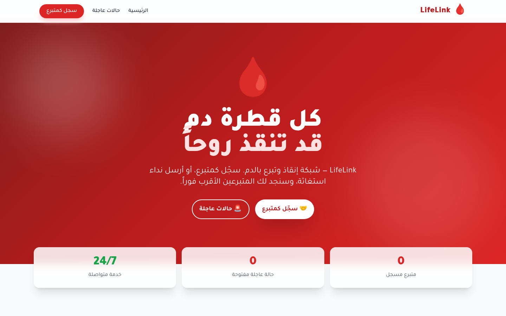

<p align="center">
  
</p>

# 🩸 LifeLink — شبكة إنقاذ وتبرع بالدم

> **لأن كل قطرة دم قد تنقذ روحاً.**

LifeLink هي منصة ويب مفتوحة المصدر (Open Source) تربط **المتبرعين بالدم** مع **المستشفيات والمرضى** الذين يحتاجون إلى دم عاجل. تهدف إلى تقليل الوقت بين "الحاجة" و"الإنقاذ" إلى أدنى حد.

<p align="center">
  <a href="https://github.com/tibatechapp-ship-it/lifelink-app/actions/workflows/ci.yml"></a>
  <a href="LICENSE"></a>
  <a href="https://github.com/tibatechapp-ship-it/lifelink-app/releases"></a>
  
  
  
</p>

---

## 🔒 الخصوصية أولاً (Privacy-first)

بيانات المريض (الاسم، المستشفى، الهاتف) **لا تظهر في أي قائمة عامة** — القوائم تعرض الحد الأدنى اللازم للوصول السريع: (فصيلة الدم، المدينة، الاستعجال). بيانات النداء الكاملة تُجلب **فقط عند طلبها** من نقطة التفاصيل: للمستخدم الموثوق تُعرض مع أزرار الاستجابة، وللزائر يظهر إرشاد خصوصية واضح بدل حقول مكسورة. الحقول الحساسة مشفّرة fail-closed على مستوى النموذج، وإنشاء المتبرع/النداء للزائر مقيّد معدلاً ومحكوم باختبارات عقد خصوصية آلية.

## ✨ الميزات

- 📝 **تسجيل المتبرعين** — فصيلة الدم، المدينة، بيانات التواصل
- 🚨 **نداءات استغاثة** — نشر طلبات دم عاجلة مع مستوى الأهمية (حرجة/عاجلة/عادية)
- 🔍 **بحث وفلترة** — حسب فصيلة الدم، المدينة، مستوى الأهمية، الحالة
- 🔒 **PII-minimal** — قوائم بلا بيانات شخصية + جلب التفاصيل عند الطلب فقط
- ♿ **وصولية a11y** — نماذج موسومة، نوافذ حوارية بالكيبورد، skip link، تباين AA
- 📱 **متجاوب 100%** — Mobile-first design
- 🎨 **واجهة عالمية** — Tailwind CSS + animations
- 🐳 **Docker-ready** — نشر سهل
- 🔌 **REST API** — CRUD كامل (JSON)

## 🛠️ التقنيات

- **Backend:** Python 3.11+ / Flask 3.1
- **Database:** SQLite (Flask-SQLAlchemy) · **الإنتاج:** PostgreSQL + Alembic
- **Frontend:** HTML5 + Tailwind CSS (CDN) + Vanilla JS
- **Fonts:** Tajawal (Arabic)
- **Deployment:** Docker

## 📸 لقطات

| الصفحة | اللقطة |
|---|---|
| الرئيسية — عدادات حية ورحلة سريعة |  |
| حالات عاجلة — قوائم PII-minimal مع فلترة |  |

## 🚀 التشغيل (Run Locally)

```bash
# 1. Clone
git clone https://github.com/tibatechapp-ship-it/lifelink-app.git
cd lifelink-app

# 2. Install dependencies
pip install -r requirements.txt

# 3. Run
python app.py
```

افتح المتصفح على: http://127.0.0.1:5000

## 🧪 الاختبارات

```bash
pip install -r requirements-dev.txt
pytest tests/ -q          # 70 اختباراً: مصادقة، تحقق، حد معدل، هجرات، خصوصية
```

## 🐳 تشغيل عبر Docker (SQLite)

```bash
docker build -t lifelink .
docker run -p 5000:5000 -e SECRET_KEY="$(openssl rand -hex 32)" lifelink
```

## 🚢 النشر (Postgres + Migrations)

الإنتاج لا يستخدم SQLite: القاعدة **PostgreSQL**، والمخطط يملكه **Alembic**.

```bash
cp .env.example .env            # املأ DB_PASSWORD و SECRET_KEY
docker compose up -d --build
curl -s localhost:5000/ready    # 200 فقط عندما تجيب القاعدة
```

- **المسار الوحيد للنشر** = صورة واحدة تُشغّل `scripts/entrypoint.sh`:
  `alembic upgrade head` ثم `gunicorn`. الهجرات تعمل **قبل** الاستماع للطلبات،
  وإن فشلت يموت الحاوية بصوت عالٍ بدل أن يخدم الإصدار القديم مخططاً ناقصاً.
- `db.create_all()` يعمل على SQLite فقط (تطوير/اختبارات). على Postgres المخطط
  ملك Alembic — وإلا لحجب `create_all` فشل الهجرة بإنشاء الجداول بصمت.
- `DATABASE_URL` واحد فقط: الصيغ التي تمنحها المنصات (`postgres://`) و
  (`postgresql://`) تُعاد كتابتها إلى `postgresql+psycopg://` في `models/database.py`،
  لأن SQLAlchemy 2 أسقط الـalias و`postgresql://` يختار psycopg2 غير المثبَّت.
- `SECRET_KEY` إلزامي في الإنتاج: `FLASK_ENV=production` + فارغ ⇒ توقف فوري.
  في compose أيضاً `${SECRET_KEY:?}` و`${DB_PASSWORD:?}` يمنعان الإقلاع.

### الهجرات

```bash
alembic upgrade head                       # تطبيق (يشغله الـentrypoint)
alembic check                              # يفشل إذا انحرف الموديل عن الهجرة
alembic revision --autogenerate -m "msg"   # بعد تعديل models/
alembic current                            # الإصدار الحالي
```

CI يشغّل الهجرة على **Postgres حقيقي**: upgrade مرتين (idempotent)، downgrade
إلى base ثم upgrade، ثم `alembic check`، ثم يبني الصورة ويشغّلها وينتظر
`/ready` = 200.

### المراقبة

| المسار | المعنى |
|---|---|
| `/health` | العملية تعمل — **لا يلمس القاعدة** (فحص ينتظر القاعدة يخلق restart loop) |
| `/ready` | هل نرسل حركة مرور؟ `SELECT 1` ⇒ 200، وإلا 503 مع `checks[0].error` |

## 📡 API Endpoints

### Ops (مراقبة)
- `GET /health` — العملية تعمل (200 دائماً، لا يلمس القاعدة)
- `GET /ready` — القاعدة تجيب: 200 `{"ready": true, ...}` أو 503 `{"ready": false, "checks": [...]}`

### Donors
| Method | Endpoint | Description |
|---|---|---|
| GET | `/api/donors` | List donors (filters: `blood_type`, `city`, `available`) |
| GET | `/api/donors/<id>` | Get donor by ID |
| POST | `/api/donors` | Register new donor |
| PUT | `/api/donors/<id>` | Update donor |
| DELETE | `/api/donors/<id>` | Delete donor |
| GET | `/api/donors/search?blood_type=&city=` | Search available donors |

### Emergencies
| Method | Endpoint | Description |
|---|---|---|
| GET | `/api/emergencies` | List (filters: `status`, `blood_type`, `city`, `urgency`) |
| GET | `/api/emergencies/<id>` | Get by ID |
| POST | `/api/emergencies` | Create emergency request |
| PUT | `/api/emergencies/<id>` | Update (e.g. status=fulfilled) |
| DELETE | `/api/emergencies/<id>` | Delete |
| GET | `/api/emergencies/open` | Open emergencies sorted by urgency |

### Health
| Method | Endpoint | Description |
|---|---|---|
| GET | `/health` | Service health check |

## 🤝 المساهمة (Contributing)

نرحب بمساهماتك! اقرأ [CONTRIBUTING.md](CONTRIBUTING.md) لبيئة التطوير وسير العمل ومعايير القبول، و[SECURITY.md](SECURITY.md) للإبلاغ الأمني المسؤول. باختصار:

1. افتح Issue للمناقشة أولاً (الميزات الجوهرية)
2. فرع من `main`: `feat/...` أو `fix/...`
3. شغّل `pytest tests/ -q` محلياً حتى الأخضر
4. افتح PR بالقالب المجهّز

## 📄 الترخيص (License)

MIT License — free to use, modify, and distribute.

## 🌟 Vision

LifeLink believes that **no one should die waiting for blood**. Every registered donor is a potential lifesaver. Every second saved is a life gained.

**Made with ❤️ for humanity.**

## 🧾 Technical Debt / Future Work

Notes from a **Deep Multi-Agent Audit** performed with the **nexus-core** council
(members: profiler, analyst, critic). Verdict: `reject` (score 0.15). Tracked in
[Issue #1](https://github.com/tibatechapp-ship-it/lifelink-app/issues/1).

- [ ] **التحقق الهاتفي** لنداءات الزائر (verified=False حالياً — يتطلب مزود SMS)
- [ ] Pagination on list endpoints.
- [ ] CSRF protection for browser forms.

### Already addressed
- ✅ **Authentication / Authorization** — JWT + أدوار + حماية PII fail-closed (كانت في قائمة الدين)
- ✅ **PostgreSQL + Alembic migrations** — منفذ ومحكوم بالـCI
- ✅ **Rate Limiting** — على نقاط الإنشاء العامة
- ✅ Input validation (ranges, enums, regex) on all donor/emergency endpoints.
- ✅ XSS escaping in templates via `esc()`.
- ✅ DB indexes on `blood_type`, `city`, `status`, `urgency` + composite indexes.
- ✅ Timezone-aware UTC timestamps (`datetime.now(timezone.utc)`).
